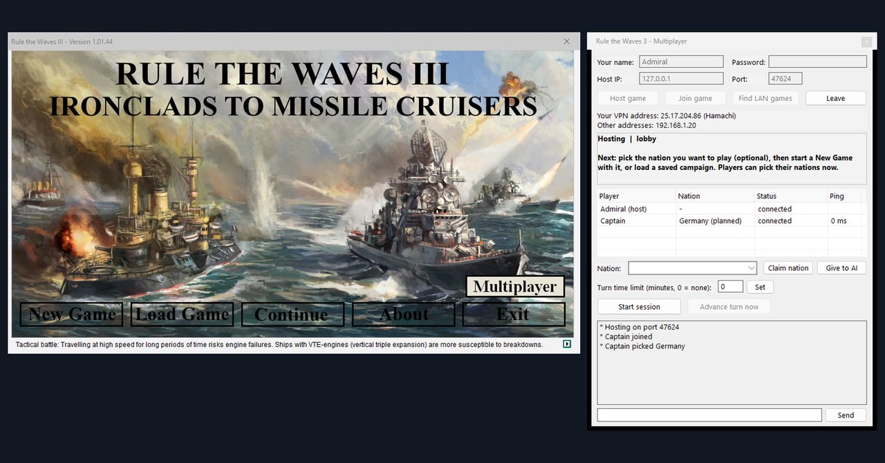
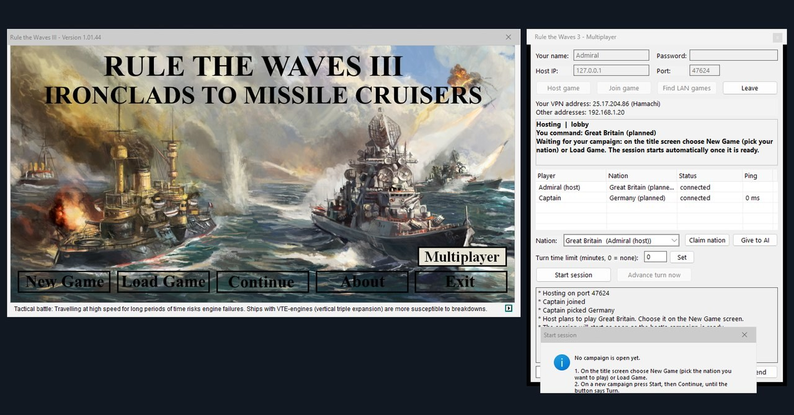
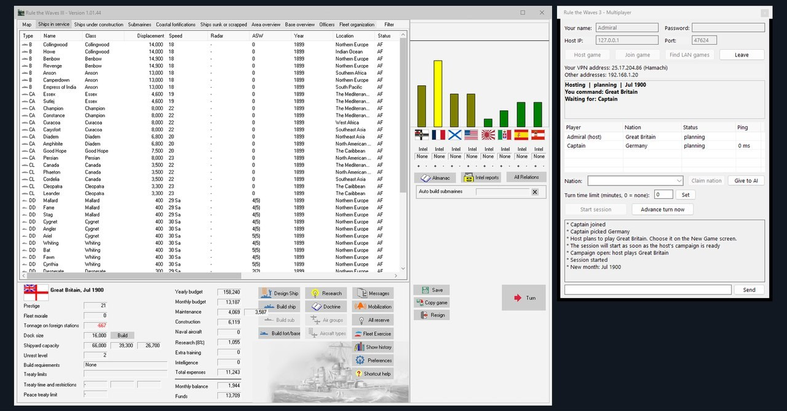
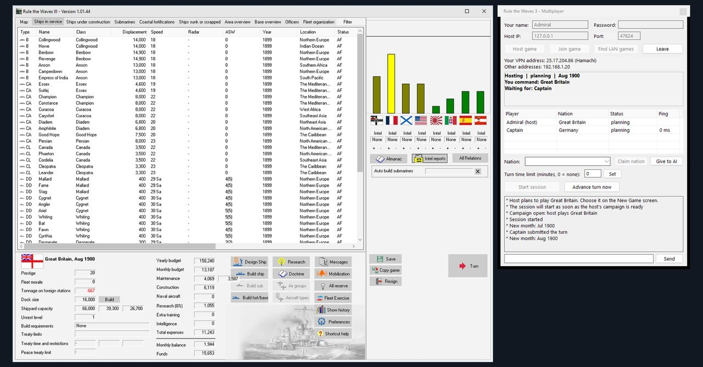

# RTW3 Multiplayer (unofficial mod for Rule the Waves 3)

Play one Rule the Waves 3 campaign with friends. Each human commands a different navy; every other nation stays
AI-controlled, as in single player. The host's game is authoritative: it runs all game logic and the turn timer.
Connect with Hamachi or any VPN/LAN (ZeroTier, Radmin VPN, a real LAN).

Built for Rule the Waves 3 **1.01.44** (Steam). What changed in each version: [CHANGELOG.md](CHANGELOG.md).

## Contents
- [How it plays](#how-it-plays)
- [Requirements](#requirements)
- [Install](#install)
- [Uninstall](#uninstall)
- [Network setup](#network-setup)
- [Hosting a session](#hosting-a-session)
- [Joining a session](#joining-a-session)
- [Your nation's relations, wars and money](#your-nations-relations-wars-and-money)
- [Diplomacy between players](#diplomacy-between-players)
- [Tactical battles](#tactical-battles)
- [Known limitations](#known-limitations)
- [Troubleshooting](#troubleshooting)
- [Building from source](#building-from-source)
- [Credits](#credits)
- [License](#license)

## How it plays
- One monthly turn at a time, with everyone planning at once:
  1. The host sends the current month to every player.
  2. Each player plans their own nation: design and build ships, deploy fleets, set budget, research, training and
     bases.
  3. Players press **Submit**, which replaces the Turn button for joined players.
  4. When everyone has submitted, or the host's time limit runs out, the host merges all orders.
  5. The host runs the real month, with the AI switched off for human-controlled nations, and sends the new month to
     everyone.
- The host plays their campaign's own nation (the one chosen at New Game). Joining players pick any of the 8 AI
  opponents in that campaign.
- Players can ally with each other, declare war and make peace with buttons in the Multiplayer window (see
  [Diplomacy between players](#diplomacy-between-players)). A war between players ends with peace terms for the
  winner, as in single player: land, ships and reparations.
- Each joined player's nation follows the player's rules of single player with the computer's nations: its own
  tension changes, war warnings, wars and peace, with their dialogs on that player's screen at the start of the month,
  the effects of its wars (blockades, allies, the raider and submarine war), its invasions, and the player's money
  rules (see [Your nation's relations, wars and money](#your-nations-relations-wars-and-money)).
- Every player fights their own nation's tactical battles on their own PC; battles between players are fought live by
  both players at the same time (see [Tactical battles](#tactical-battles)).

## Requirements
- Rule the Waves 3 version **1.01.44** from Steam, on Windows. Steam must be running when you play.
- **Every player needs the same game version, and should have the same mod version.** The host refuses a player whose
  game version differs, or whose mod version can't play with the host's (see [CHANGELOG.md](CHANGELOG.md)).
- A network between the players: Hamachi, ZeroTier, Radmin VPN or a real LAN. The host's PC must accept incoming
  connections (see [Network setup](#network-setup)).

## Install
Every player:
1. Close the game.
2. Download `RTW3MP-<version>-win32.zip` (for example `RTW3MP-0.7.1-win32.zip`) from the
   [latest release](https://github.com/Kizitor/RTW3-Multiplayer/releases/latest) and extract all its files into the
   game folder, next to `RTW3.exe`. When you update, replace the older files.
   On Steam, the game folder is Library > right-click Rule the Waves 3 > Manage > Browse local files.
3. Start the game normally from Steam. The title screen gets a **Multiplayer** button above *Exit*. You can also
   press **Ctrl+Shift+M** anywhere in the game.

The zip holds `version.dll` (the loader), `RTW3MP.dll` (the mod), `RTW3MP_SecondCopy.bat` (starts a second copy of
the game to try multiplayer on one PC), `RTW3MP_README.txt` and `RTW3MP_LICENSES.txt`. The release also offers the
two DLLs on their own, for updating an existing install. Updating from an older version? See
[Upgrading from an older version](#upgrading-from-an-older-version).

## Uninstall
1. Close the game.
2. Delete `version.dll`, `RTW3MP.dll` and the other `RTW3MP_*` files from the game folder.
3. If you like, also delete the mod's settings and logs (the folder `Documents\My Games\Rule the Waves 3\RTW3MP`)
   and, on a joined player's PC, the save slots `Game77` and `Game87` in `Documents\My Games\Rule the Waves 3\Save`
   (the copies of the multiplayer campaign).

The mod never modifies `RTW3.exe` or the Steam DRM. A campaign you host stays a normal save in its own slot; the mod
keeps its session settings next to it, in `rtw3mp_session.ini`, and during a live battle `rtw3mp_livebattle.ini`, so
that the battle can be resumed if the host's game stops.

## Network setup
Hamachi example:
1. Every player installs LogMeIn Hamachi. The host creates a network; everyone else joins it.
2. The host opens the Multiplayer window. Under the buttons, "Your VPN address" shows the host's Hamachi IP
   (25.x.x.x). ZeroTier and Radmin VPN addresses are shown the same way.
3. Allow `RTW3.exe` through Windows Firewall on private networks; the host's PC must accept incoming connections.
   The game uses TCP port **47624** (the **Port** box), and UDP port 47625 (the port + 1) for **Find LAN games**.

## Hosting a session

**Video walkthrough (1 minute):** [docs/hosting.mp4](docs/hosting.mp4). It shows the host's screen from the title
screen to the first processed month; a second copy of the game plays the joined player "Captain". The video and the
pictures below were made with version 0.1: today's Multiplayer window also has the **Fight my battles**,
**Computer flies carrier strikes in live battles** and **Manual legacy fleets** checkboxes (a joined player sees
**Build my legacy fleet by hand (a new campaign's first month)** in their place) and the Diplomacy list. The
addresses in them are examples.

1. Open **Multiplayer**, enter your name, optionally a password and a turn time limit in minutes (0 = none), and
   press **Host game**. Players can join and pick nations right away. Give them the VPN address shown under the
   buttons (Hamachi addresses start with 25.).

   
2. Optionally pick the nation you plan to play and press **Claim nation**, so others see it. You play the nation you
   choose on the New Game screen.
3. Start a **New Game** (or load a save). When the campaign opens, everyone's picks are matched to it automatically.
   If a pick isn't in that campaign, the chat asks that player to pick another.
4. Press **Start session**. You can press it any time after hosting: if the campaign isn't ready yet (no campaign
   open, or a new campaign still in its Start/Continue setup steps), the window tells you what's left and the session
   starts by itself once the campaign is ready.

   

   
5. Each month, press **Turn** when you're ready (or **Advance turn now** in the Multiplayer window). If players are
   still planning, you can wait (the turn starts by itself when everyone submits) or advance now. Any nation that
   hasn't submitted keeps last month's orders. The game asks its usual end-of-turn questions on the host's screen.

   
6. If the players have battles to fight after the month, your screen shows "Battles in progress" and waits for them
   (see [Tactical battles](#tactical-battles)).
7. To continue later, load the same save and host again. Nation assignments are remembered per campaign
   (`rtw3mp_session.ini` in the save slot), and returning players get their nation back automatically.

- **Time limit:** when it runs out, every player's current orders are submitted automatically and the month starts.
  You can change the limit during the session with **Set**.
- **Players who leave:** a player who joins again with the same name gets their nation back. Until then the nation
  keeps its last orders; the computer doesn't take it over. To hand a nation to the computer, select it under
  **Nation** and press **Give to AI**. A player who drops out of a live battle gets their ships back the same way (see
  [When a player drops out or the host's game stops](#when-a-player-drops-out-or-the-hosts-game-stops)).
- **Carrier strikes in live battles:** tick **Computer flies carrier strikes in live battles** to let the computer
  fly both sides' carrier strikes (see [Commands in live battles](#commands-in-live-battles)).
- **Legacy fleets of joined players:** with **Manual legacy fleets** ticked (the default), each joined player may build
  their nation's starting ("legacy") fleet by hand in a new campaign's first month, as the game's **Manual build of
  legacy fleet** lets you do for your own nation (see [Joining a session](#joining-a-session)). A hand-built fleet can
  give a player an edge: the computer's nations built their fleets with the campaign and don't answer it (see
  [Known limitations](#known-limitations)). Untick the box before you start the session to give every joined player
  the fleet the game generated. The chat tells you when a player builds one and when it is in the campaign.

## Joining a session
1. Open **Multiplayer**, enter your name, the host's IP (or use **Find LAN games**) and the password. Leave **Fight my
   battles** ticked to fight your own battles (see [Tactical battles](#tactical-battles)); you can change it only
   before you join. Then press **Join game**.
2. Choose a nation in the list and press **Claim nation**. You can do this before the host has a campaign; your pick
   is matched when the host opens one. A refused pick is explained in the chat.
   - **To build your legacy fleet by hand** in a new campaign, tick **Build my legacy fleet by hand (a new campaign's
     first month)** before the host starts the session, as you would tick the game's **Manual build of legacy
     fleet** for a new campaign of your own. It works in the campaign's first month only, once, and only if the host
     allows it (**Manual legacy fleets**). Your nation's generated fleet, its ship designs and its divisions (**Fleet
     organization**) are then replaced by what you build: the game's own screens open in its "Construct initial
     fleet" mode, with the game's budget for a manual build, as in single player (four months of your nation's budget
     less 10 %, scaled by the nation's own factor in the game's data; your prestige drops by one). Design your classes
     with **Design Ship**, build them with **Build ship**, then press **Continue**: money over the game's limit is
     lost, as in single player. Choose your ships under construction, press **Continue** again, then plan the month
     and **Submit** as usual. If the host starts the month first (its time limit or **Advance turn now**), your fleet
     is submitted as it is.
3. When the host starts, the month loads automatically and you play as your nation. Your copy lives in save slot
   `Game77` (your battles in `Game87`), so your own saves are never touched. At the start of each month, first answer
   your nation's dialogs: its random event, if any, and its relations (see
   [Your nation's relations, wars and money](#your-nations-relations-wars-and-money)).
4. Plan your month and press **Submit**. You can keep changing orders and submit again until the host processes the
   turn. Like the game's **Turn** button, **Submit** first asks whether to go on when too few of your ships are on
   trade protection (at war) or on foreign stations; **No** takes you back to your planning. (A submit forced by the
   host's time limit asks nothing.)
5. To keep your own copy of the campaign, use the game's **Copy game** button. The copy is made for your nation: you
   play your nation in it, and the host's nation is run by the computer. It is a normal single-player save and doesn't
   affect the multiplayer session. (This also works after you leave the session, as long as slot 77 still holds the
   multiplayer game.)
   - You keep your nation, its fleet, designs, possessions, budget, research, relations and wars.
   - The host's officers come with the copy, unassigned. The host's divisions don't; your own do (0.6.1 or newer).
   - Tech-sharing deals start over.
6. If you leave or lose the connection, join again with the same name: you get your nation back, and your ships if
   your live battle is still going on (see
   [When a player drops out or the host's game stops](#when-a-player-drops-out-or-the-hosts-game-stops)).

Your screen shows your own nation's side of the campaign:
- **Relations:** the tension panel, its war and alliance marks, the map's strength bars and the *War results* box
  show your nation's relations, wars and alliances. The host's nation takes your own nation's place in the panel. The
  line under your nation's name counts your nation's own months at war ("At war for N months.") or at peace.
- **Intelligence:** the levels under the flags and their + and - buttons, the budget's *Intelligence* line and the
  intelligence reports are your own, and your nation pays for its spending. Your monthly spying check runs on your
  PC, with the game's own messages.
- **Trade protection and foreign stations:** the budget panel shows your nation's trade protection requirement,
  **Submit** asks the game's questions (step 4), and the host's month gives your nation the game's warnings and
  their consequences (for example lost prestige), which you get as notices with the new month. Your ships on trade
  protection or raiding keep these orders from month to month while your nation is at war; at peace the game sends
  them back to active service, as in single player. (Before 0.7.1 the host's month sent them back every month.)
- **Divisions:** the *Fleet organization* tab shows your own nation's divisions. Make and change them as in single
  player: they go to the host with your turn, come back with every new month, and the game sets up your side of your
  battles against computer nations with them. (Before 0.6.1 the tab showed the host's divisions, and yours were lost
  every month.)
- **Ship data:** the game's *View data* (the ship lists' popup menu) shows your own ships' data. (Before 0.7.1 it
  showed nothing, or another nation's ship.)

Your relations on the screen need 0.4.1 or newer on your PC, and your own months at war need 0.5.0 or newer on your PC
and on the host; your intelligence and the month's warnings need 0.4.1 or newer on the host too, your own divisions
0.6.1 or newer on your PC, your ships' trade protection and raider orders 0.7.1 or newer on the host, and *View data*
0.7.1 or newer on your PC (see [Upgrading from an older version](#upgrading-from-an-older-version)). What still comes
from the host or the computer: see [Known limitations](#known-limitations).

To test on one PC, run two copies of the game and join `127.0.0.1` (`RTW3MP_SecondCopy.bat` from the release starts
the second copy). Both copies share one settings file, so the joining copy gets a numbered name (e.g. "Friend 2").

## Your nation's relations, wars and money
With 0.5.0 or newer on the host and on your PC, your nation's relations with the computer's nations, its wars, its
peace and its money follow the player's rules, as when you play your nation in single player, and with 0.6.0 the
effects of its wars too (see *War effects* below). The computer's rules for the nations it plays no longer decide
them. (With an older version on either PC, your nation keeps the computer's rules for its relations, and with an older
host for its money too: see [Known limitations](#known-limitations).)

**The start of your month.** When the new month loads, your game first shows the messages of your nation's money
rules from the month just processed, if any (in the game's turn report: see *Money* below), then rolls for your
random event, then runs your nation's relation routines, and you answer their dialogs on your own screen:
- random tension changes, with the game's explanations, your leader's speeches, and other nations' questions and
  alliance offers (only in a month without a random event, as in single player);
- the effect of previous wars on tension;
- war plans with your spies' warnings and rumours, declarations of war ("Russia has declared war on us!"), and
  nations that join a war against you or on your side;
- at a war's start with a computer nation, the game's surprise moves (with 0.6.0 on the host and on your PC): a
  computer nation's takeover of an unowned possession, with 0.7.0 its landing in one of your possessions, and a
  surprise attack, which you play after the month (see [Battles against AI nations](#battles-against-ai-nations));
- at war with a computer nation, the help of your allies, the seizure of ships building in your enemies' yards and in
  yours, and a revolution in an enemy nation (with 0.6.0 on the host and on your PC; see *War effects* below);
- at war with a computer nation, the game's peace offer, when it makes one (see *Peace* below).

Then the game's turn report lists the month's messages (for example "Tension with Spain is reduced as they do not
want to raise tensions with a strong nation."). The host applies the results at once, before it runs the month. Its
screen shows none of your dialogs, and everyone's chat gets a line for a new war ("* War: Russia and Germany are now
at war.") or a peace. Answer the dialogs while the host still waits for the month's turns: if the host starts the
month first (its time limit, or **Advance turn now**), they don't count for that month. The routines run only on your
PC, so they don't run in a month in which you aren't connected. If the host's game stops during the month, the host
keeps what it has applied: it saves its campaign right after applying your relation turn or peace (while one of its
game's dialogs is open, as soon as it closes).

**Wars.** A war between your nation and a computer nation comes by these rules: the computer nation plans it (your
spies may warn you) and declares it when tension is high enough, and other nations may join either side. The host's
month no longer starts or ends your wars by the computer's rules. Your nation counts its own months at war or at
peace (the line under your nation's name), and your events and relation routines go by it.

**War effects.** With 0.6.0 on the host, your nation's wars with the computer's nations have the effects that single
player gives the player's wars, by your nation's own months at war and war score. The host's month runs most of them,
and their messages come in your game's turn report at the start of the new month:
- **Blockades:** your blockades of your enemies and theirs of you give victory points ("Gain 100 VP for blockade of
  enemy", "The enemy gains 90 VP for blockading us") and affect the blockaded nation's ship movements, trade and
  unrest ("Shortages due to the blockade are causing hardship for our people!"). Your allies at war add their ships
  to your blockades, and your enemies' ships count together against you. With 0.6.0 on your PC too, the relations
  panel marks the blockades of your wars.
- **The raider and submarine war:** your raiders and submarines sink your enemies' merchant ships and theirs sink
  yours, with victory points against each enemy, the game's messages and a monthly summary ("Trade war this month:
  our raiders sank ..."). With 0.7.0, raiders and patrols also meet in battle (see
  [Battles against AI nations](#battles-against-ai-nations)).
- **War weariness:** your unrest grows when your war goes badly ("Our people is getting dissatisfied with the bad war
  situation!"), for the governments that the game applies it to.
- **The wartime build rules:** construction delays, submarine building and the war budget ("War budget means
  increased allocations to the navy!") go by your own war; war loans come as in 0.5.0.

With 0.6.0 on your PC too, the start of your month at war brings the game's dialogs for:
- **Help from allies:** your allies' operations add victory points ("The operations of our ally USA adds 13VP"),
  allies join your war ("Our ally USA joins the war against Russia!"), quarrel or hesitate (with the game's questions
  about lend-lease ships, money and the alliance), and nations at war with your enemy offer an alliance.
- **Ship seizures:** your ships building in a computer enemy's yards are seized, and you seize its ships building in
  yours.
- **Revolutions in enemy nations:** a computer enemy in turmoil can be forced to make peace: a peace with all your
  computer enemies, or a separate peace with that one while the others fight on ("The other members of the enemy
  coalition resolve to fight on.").

In a war with another player's nation, war weariness works as well, but your allies don't help and no revolution ends
it. Between two joined players' nations, each side scores its own blockades, but there is no raiding and no seizure
of ships (see [Known limitations](#known-limitations)). In a war with the host's nation, the blockades, the raider and
submarine war and ship seizures follow the game's rules for the host's wars, on the host; when the host blockades
you, the host gets the points and you the unrest and the messages.

**Treaties.** A naval arms limitation (disarmament) treaty ends when your nation goes to war, as the player's war ends
it in single player: the host ends it once for everyone, your turn report says "The outbreak of war cancels the
disarmament treaty!", and the chat shows it. While a joined player's nation is at war, the arms-control conference
makes no treaty ("With a war already in progress, the conference ends in solemn declarations and no action."). This
needs 0.6.0 on the host; under an older host, your game on 0.6.0 keeps the host's treaty during your war, without the
game's box.

**Peace.** As in single player, your nation makes peace with all the computer's nations at war with it at once, in
one of two ways:
- **The game's peace offer:** at the start of a month at war, the game can bring you its peace event, and you answer
  it as in single player.
- **Propose peace:** the **Diplomacy** list of the Multiplayer window has a row for each computer nation at war with
  you (player "computer", relation "At war", and your war score against it, *VP yours:theirs*). Select it, press
  **Propose peace** and confirm: the game's own peace talks start at once, with their dialogs on your screen. Your
  proposal is the game's offer of a compromise peace, and the enemy can refuse it. You can propose once a month,
  after the month's relation dialogs and before you submit, and not in a month in which you answered a peace offer.
  Single player has no such button.

The terms are the game's, with its dialogs: possessions you gain (you choose them in "Select possessions as part of
peace agreement") or cede, ships you hand over when you lose, base resources, prestige, and the end of your months at
war and of the blockades. The host applies them at once, so the possessions and ships change hands for everyone, and
the chat shows the treaty ("* Peace treaty between Germany and Spain: Germany wins.") or that the negotiations came
to nothing. Your war score against a computer nation counts the battles since the war began, as in a war between
players, and the game weighs it when it decides on its peace offers. A peace with the computer's nations doesn't end
your wars with other players (see [Diplomacy between players](#diplomacy-between-players)); while one goes on, your
nation stays at war: its months at war, budget, unrest and blockade stay as they are.

**Money.** The host's month gives your nation the balance of its budget at the player's prices, as the game does for
the player in single player, and the player's money rules, with your nation's own months at war:
- war loans during a war;
- penalties for debts (lost prestige and morale), and the money lost to corruption;
- cuts when your nation hoards money: budget cuts, money taken, and army offensives that take a tenth of your budget
  for some months (your budget screen shows the cut);
- at peace, the rules for a small fleet: complaints, and budget changes (for example when another nation threatens
  yours);
- under a naval treaty, the player's budget cut (two steps).

Their messages come at the start of the new month, in the game's turn report. The bonuses that the computer gives
the nations it plays no longer reach your nation (a monthly sum that grows with the fleet, "... has increased the
naval budget to remain a global naval power."), and the computer no longer decides for your nation in the host's
month: it doesn't halt or resume your ships under construction, set your doctrine or ammunition, send ships home
from colonies, order and pay for escorts and ASW patrols, change your air groups, offer the host technology deals in
your name, buy scrapped ships with your money, scrap your armed merchant cruisers after a peace, or, when you play
China, cut its base resources and budget by its concessions rule. The money rules need 0.5.0 or newer only on the
host. A few of the game's rules still work differently for joined nations: see
[Known limitations](#known-limitations).

## Diplomacy between players
Human players decide war and alliances with each other themselves; they don't have to wait for the relation
(tension) bar. The **Diplomacy** list in the Multiplayer window shows every other player's nation with your current
relation, the tension value of the relation bar, and anything pending. Select a nation, then:

| Button | Effect |
|---|---|
| **Declare war** | One-sided. Asks for confirmation; you can withdraw it until the month is processed. Breaks an alliance between you. |
| **Propose alliance** / **Accept alliance** | Offers an alliance. When the other player offered one to you, the button reads *Accept alliance*. |
| **Propose peace** / **Accept peace** | Offers peace while you are at war; *Accept peace* when they offered it. The winner of an agreed peace gets **Claim land...** here (see [Peace terms](#peace-terms-between-players)). |
| **Leave alliance** | One-sided. Ends the alliance (or calls off an agreed alliance that hasn't started yet). |
| **Withdraw** / **Decline** | Takes back your own offer or declaration, or declines the other player's offer. |

- Everything takes effect when the host processes the month, the same way a war breaks out at month end in single
  player. Everyone sees the result in the chat and in the Diplomacy list of the new month; the relation bars and ally
  flags on the two players' screens change too (a joined player's since 0.4.1).
- Diplomacy is possible while players plan a month (not in the lobby or while the turn is processed).
- Agreements made with the buttons are kept: an alliance between players doesn't run out and the AI never cancels it.
  A war declared with the buttons lasts until both players agree to peace, even if the game's own peace routines
  would end it (for example a peace treaty the host signs with an AI nation, which in Rule the Waves ends all of the
  host's wars at once, or a joined player's peace with the computer's nations).
- The relation bar keeps moving as in single player: the joined players' relation routines, the host's and the events
  still raise and lower the tension between players. But a joined player's nation that follows the player's rules
  (0.5.0 or newer on the host and on that player's PC) never goes to war with another player's nation by itself:
  such a war starts only with **Declare war**.
- **The war line:** the bar between two players' nations can therefore rise far above the tension panel's war line,
  where a computer nation would soon declare war, and stay there: the game never starts that war. Since 0.6.1 the
  bar's tooltip says so ("Tension with Germany is 25 - played by a person: wars between players are declared only in
  the Multiplayer window (Diplomacy), never by the game"), and each time the tension between two players' nations
  rises to 11 or more (the bar crosses the line), a host on 0.6.1 tells both players once in the chat: "* Tension
  between Great Britain and Germany is 25, above the war line. Wars between players are declared only by the players
  (Multiplayer window, Diplomacy); the game will not declare one."
- Under an older host, or with an older version on the joined player's PC, the nation keeps the computer's rules, and
  the game can still start a war between it and another player's nation on its own (rising tension, or an ally being
  drawn into a war). With 0.6.1 on the host, the host's game never declares one between the host's nation and a
  player's nation, also while that player isn't connected. Those wars can be ended with **Propose peace** too.
- Computer nations can join a war between players on either side, as other nations join the player's wars in single
  player (the host is told, for example, "Spain has entered the war against you on Germany's side!").
- Computer nations get no buttons, except **Propose peace** in the rows of the computer's nations at war with a
  joined player (see [Your nation's relations, wars and money](#your-nations-relations-wars-and-money)). Their
  diplomacy with each other and with the host's nation is decided by the game as in single player, and with a joined
  player's nation by the player's rules on that player's PC.
- When the host makes peace with its last enemy, the game's normal end-of-war routine runs on the host (budget cut,
  released prisoners, and the usual messages). A joined player's peace with the computer's nations runs it on that
  player's PC.

### Peace terms between players
A war between two players ends like a war against the AI in single player: the side that is clearly ahead wins
concessions.
- **War score:** the **Tension** column of a war shows the victory points (VP) both sides scored in this war (*VP
  yours:theirs*), counted from every battle between the two nations: the host's battles, live battles between
  players and the battles the game resolves on its own. The label above the list tells you what a peace would bring
  now.
- **Who wins:** the game's own rules for "winning the war" are used. A side with at least twice the enemy's points and
  a clear margin wins a *major victory*; a side with a smaller lead but enough points wins a *minor victory*;
  otherwise the peace is a compromise without terms. The margin grows with the era, as in single player.
- **The terms are fixed when the peace is accepted** and shown in the chat and the Pending column. They take effect
  when the month is processed:

  | | Minor victory | Major victory |
  |---|---|---|
  | Possessions the winner may take (total value) | up to 4 | up to 8 |
  | Ships handed over as war reparations | up to 1 | up to 3 |
  | Winner's prestige | +1 | +2 |
  | Loser's base resources | −100 | −500 |

  The loser also loses prestige, as after a lost war in single player, and never more than half of its base
  resources. The rules of single player apply: only possessions worth less than 11 can be taken, and only in sea
  areas next to the winner's own possessions; ships handed over are recent, large ships that are not under repair
  (if the loser has none, fewer ships change hands).
- **Claim land:** after the peace is accepted, the winner's **Propose peace** button reads **Claim land...**. It
  opens a list of the loser's possessions that may be taken, with their value and oil. Tick the ones you want, up to
  the limit, and press **Claim selected**. You can change the choice until the month is processed. If you don't
  choose (or press **Let the conference choose**), the most valuable possessions that fit the limit are picked for you
  when the month ends.
- When the month is processed, both players get the game's peace treaty window with the terms, and everyone sees them
  in the chat. Withdrawing an agreed peace before then also drops its terms.

## Tactical battles
Every player fights their own nation's battles on their own PC, with the game's own battle screen. **Fight my
battles** (next to the port, on by default; set it before you join) turns this on for you. Without it, the game
resolves your battles as before, and the host fights a battle between the host's nation and yours against the
computer, as in single player.

### Battles against AI nations
- **Where your battles come from.** With 0.6.0 on the host and on your PC, the host runs the game's battle rules of
  single player for your nation once a month while it is at war with a computer nation, as the game does for the
  player: battles in your home areas, at your possessions and on the game's missions, attacks and defences, at most
  one a month. With an older version on either PC, your battles come from the computer's battle rules, as before: when
  your ships and a computer nation's meet in an area during the month.
- After the month, before the new month is sent, the host sends each player their battles, one at a time. The host's
  screen shows "Battles in progress" and is locked until they are done.
- On your PC the battle opens as in single player, with the game's questions (for example on the map) and its battle
  preview, and since 0.6.1 with your side set up from your own divisions. Fight it to its end, close the results, and
  the result goes back to the host: damage, sinkings, crew experience, victory points and prestige. Then your own game
  loads again, and the new month follows.
- **Declining:** with 0.6.0 on the host and on your PC, a battle you decline (on the map or in the preview) counts as
  in single player: the enemy gets its points, and after the game's warnings repeated declines cost prestige or fleet
  morale. The host keeps your nation's own count of declined battles. Everyone's chat shows it ("* Captain declined
  battle for Germany against Spain in Northern Europe."). With an older version on either PC, the game resolves a
  declined battle as one between computer nations.
- If you leave the battle before its end, disconnect, or don't finish within the time limit (30 minutes per battle),
  a battle of the player's rules is dropped: no battle for you that month ("* No battle of Germany this month
  (...)"). A battle of the computer's rules is resolved by the game the old way; from a host on 0.6.0 its messages
  come in the chat and in your turn report. With 0.6.1 on the host it is no battle when your nation or the enemy no
  longer has a ship there that can fight (for example after another battle of the month).
- If the computer's navy declines the battle ("The ... navy declines battle! You gain N VP!"), there is no battle and
  you keep the points, as in single player (with 0.4.1 or newer on the host and on your PC; otherwise the game
  resolves the battle as one between computer nations).
- **Surprise attacks:** with 0.6.0 on the host and on your PC, a war between your nation and a computer nation that
  starts at the start of your month can bring the game's surprise attack of single player: a nation with the game's
  surprise attack trait strikes you, or you it ("Mobilize all ships for the surprise attack?"). The chat announces it
  ("* Surprise attack? Japan may strike Germany at the war's start. Captain plays it after the month."), and you play
  it with your battles after the month, not at once as in single player.
- **Raiders and patrols:** with 0.7.0 on the host and on your PC and **Fight my battles** on, your raiders can be
  intercepted by enemy patrols and your patrols (ships on trade protection or on a foreign station) can intercept
  enemy raiders, with the game's chances of single player: the month's battle search checks the raiders up to twice
  (each time with a chance of 30 %), and an interception is the month's battle. You play it with your battles after
  the month: the game's dialog (for example "German ship CA Blücher intercepts Spanish raider in Northeast Asia.")
  lets you *Fight Battle* (a tactical battle) or *Auto resolve* it (the game's quick resolution and its messages).
  Either result goes back to the host: sunk and damaged ships, victory points. The chat announces such a month
  ("* Battle? Germany's raiders and patrols may meet the enemy's. Captain plays it after the month."; with a battle
  the search found first, its own line ends "..., or its raiders and patrols the enemy's."), and the host's chat
  names the result ("* The raider battle of Germany against Spain in ... was auto-resolved by Captain."). The game's
  lines "Patrolling ship ... thwarts ... raider ... attack on merchant shipping in ...!" come in your chat with the
  new month. A raider check that intercepts nothing is no battle, and the month's search goes on as in single
  player. Raider battles against the host's or another player's nation don't happen. With an older version on either
  PC your nation has no raider battles (as with 0.6.x).
- **Invasions:** with 0.7.0 on the host and on your PC, your nation invades and is invaded as the player is in single
  player. Pick an invasion target with the game's own button (a possession of a computer nation you are at war with,
  worth less than 10, within your invasion range); your turn sends it, and the host's chat says if it can't be taken
  (for example a possession of the host's or another player's nation: invasions between players are not supported).
  The target costs money every month, as in single player. After each month the host resolves your invasions with the
  game's own rules, in your nation's view: the months of preparation, the weather, the strength of the fleets in the
  area, landings, the fighting on land, captures, and the computer's invasions of your possessions (its landings, the
  battles it plans and "Enemy fleets dominate the seas around ... Lose N VP!"). Its messages come in your turn report.
  The invasion battles of single player come with your battles after the month (with **Fight my battles** on; without
  it, an invasion battle that the month's invasions bring is dropped): your own invasion battle ("Our troops are
  embarking for the invasion of ...!"), the enemy's landing in your possession ("The enemy is preparing to invade
  ...!") and the battles in support of the land fighting. As in single player, a battle you decline, or one your
  fleet can't fight ("Friendly ships not available to oppose the enemy in the area!"), lets the enemy land; a won
  invasion battle lands your troops. A computer nation that starts a war on you with a surprise can land in your
  possession at once, and the computer's fleets go to defend their possessions you invade and to escort their own
  landings, as they do against the player. Your peace with a computer nation ends your invasions in that war and your
  invasion plan; the host's peace leaves them alone.
- Your battles against the host's nation and against other players' nations are live battles (below).

### Battles between players (live)
When the host's nation fights a joined player's nation, or two joined players' nations fight each other, both players
fight the same battle **at the same time**, each on their own PC and each commanding their own ships. The joined
players in the battle need **Fight my battles** on (the host's own box makes no difference; it only applies when
joining a session). If it is off, the host fights its battle against that nation's ships under computer control, and a
battle between two joined players' nations is resolved by the game.
- **Same live-battle engine:** a live battle needs the same live-battle engine on both players' PCs. 0.4.1, 0.5.0 and
  0.6.0 have the same one (17), 0.6.1, 0.7.0 and 0.7.1 a new one (18), older versions others. A host on 0.4.0 or
  newer checks it for every live battle: its own battle against a player with another engine is fought against the
  computer, and a battle between two joined players is resolved by the game unless both have the host's engine. The
  chat and the players' notices say why, naming both versions (from a host on 0.5.0 or newer, for example "live
  battles need the same live-battle engine on both PCs: the host has 0.6.1 (engine 18), you have 0.6.0 (engine 17)";
  older hosts say "the same mod version"), and the month goes on. A
  host on 0.3.x checks no versions: when it fights its own battle against a player on 0.4.0 or newer, the player's
  game refuses the battle with a notice, its chat naming both live-battle levels, and the host's computer fights the
  player's side. Two joined players with the same engine (0.4.0 or newer) fight their battle against each other live
  under such a host, which only passes its messages on; a player who drops out of it doesn't get their ships back
  (see [Known limitations](#known-limitations)).
- **Same game data files:** when a live battle starts, the two PCs compare the files of the game's `Data` folder
  (ship drawings aside). If one differs (a mod, an older or damaged install), the battle is fought against the
  computer, and the chat and the notice name the files. Since 0.6.1 the game's temporary files (names starting with
  `tmp`, such as `Data\tmpShip.ttp`, which the ship designer rewrites whenever you use it) don't count: from 0.4.1 to
  0.6.0, once a player had used the ship designer, the chat said "... game data files differ ...: Data\tmpShip.ttp",
  and their live battles were fought against the computer.
- **How it works:** both PCs run the same battle, minute by minute, and exchange their orders. One PC leads: the
  host's in a battle against the host; in a battle between two joined players, the PC of the player who starts it
  (the other player's chat names them). That player is the *first player* below, and the other one the *second
  player*. The first player's battle preferences, the ones the battle's rules use (*Realism*, *AI control*,
  *Floatplane launch*, line of sight, friendly torpedo hits, autosave, and a few message and sound options that the
  battle's random numbers depend on), apply on both PCs during the battle; every other option (sound volume, colours,
  range circles, dark mode, ...) stays each player's own. The second player's own preferences come back when the
  battle ends; their Preferences file isn't changed. Change your battle preferences after the battle: in the battle
  screen's *Preferences* they stay as they are until it ends (display options change at once). If the two PCs ever
  disagree, the battle is reloaded on both from the leading PC's state (a short
  pause); orders given in the last minute are dropped, and the chat lists the commands that were not carried out.
- **The clock is shared.** *Run one minute*, *Run 5 minutes*, *Run until break*, *Pause*, the game speed box and its
  arrows, and *Fastest available* work for both players: the battle advances when both are ready, and stops for both
  when one pauses or the game stops for a sighting. A new speed, *Fastest available*, and orders given while a minute
  is running take effect at the next minute. Choosing a speed turns *Fastest available* off.
- **Fog of war:** each player's map shows their own side as in single player, and the enemy's ships only while they
  are sighted, never the enemy's division flags. The second player's battle screen appears when the battle has
  loaded, with their own nation's ensign.
- **Ending:** both players press *End game* (the game's own rule still applies: at least half the battle and 400
  minutes, and no enemy close). When the game asks whether to end the battle (for example when the fleets are far
  apart), the chat shows its question, and both players press *End game* to agree. The game's own end (for example
  when the battle's time limit is reached) ends it for both. The result counts like any battle and the month goes on.
- Both PCs hold the whole battle, so a determined player could read the enemy's positions from memory: play with
  people you trust.

### Commands in live battles
Orders to your own divisions, ships and forces work as in single player and take effect when the next minute starts.
Detaching ships, torpedo and missile salvoes and air strikes work only while the battle is paused.
- **Force orders:** *Change force* (the ship tree's popup), and *Change lead* and *Battle turn away* (the Force orders
  dialog) work as in single player, but take effect when the next minute starts. The game's conditions are checked
  again then; an order that can no longer be carried out is reported in your chat ("Not carried out: ...").
- **Torpedo salvoes:** the division report's *Fire torpedoes*, then a target, a mount and *Fire*. The torpedoes enter
  the water on both PCs when the next minute starts ("Torpedo salvo fired: ..."). The torpedo dialog closes then: its
  firing solutions hold only for that pause. As in single player, the game offers *Fire torpedoes* only with the
  battle preference *Realism* set to Captain's mode (its third setting); in a live battle the first player's
  preference counts for both players. The game's default is Rear admiral's mode, so the first player chooses Captain's
  mode in the *Preferences* before the battle. When the battle starts, both players' chat names its Realism and whose
  preference it is ("Realism: Rear admiral's mode (...'s battle preference, for both players; ...)"), and the first
  division report that shows *Fire torpedoes* greyed out says why. Below Captain's mode your ships still fire their
  torpedoes on their own. Not while your ships are on auto-run: the computer fires their torpedoes.
- **Air strikes:** the tool bar's *Order an airstrike* (it pauses a running battle) and the reports list's *Launch
  strike* open the game's strike dialog with your own squadrons; *Launch*, *Ready* and *Stand down* work as in single
  player. Strikes fly to the target set at launch: *Confirm target location when spotted* has no effect. The computer
  flies the airfields' strikes of both sides, as in single player. The host's option **Computer flies carrier strikes
  in live battles** (in the Multiplayer window, off by default) makes the computer fly both sides' carrier strikes as
  well; the strike dialog still launches your own strikes besides them. It applies from the next live battle; when a
  battle with aircraft starts, the chat says which rule it uses.
- **Routine air operations and land-based CAP:** the tool bar's *Manage CAP and air recon*, the ship tree's *Search
  pattern* and the division report's land-based CAP button work for your own forces and divisions. CAP and scouts fly
  from each player's own settings, and your land-based CAP comes only from your own side's airfields.
- **Missiles:** both sides' missile ships fire on their own by the computer's rules, and SAMs and decoys defend
  against missiles as in single player. *Fire at will* on the missile panel is each player's own setting, on at the
  start; with it off, your missile ships fire only the salvoes you order. A change takes effect at the next minute,
  also when you make it while a minute runs. *Manual fire* opens the game's missile dialog while the battle is paused
  (pressed while the battle runs, it pauses it: press it again), but not while your ships are on auto-run. Both PCs
  fire the salvoes you order there when the next minute starts ("Missile salvo fired: ..."); until then the dialog
  still shows the missiles as before the salvo. *Fire mode* is disabled for both players (it shows *Ripple*): the
  computer chooses the salvo size of both sides' automatic fire.
- **Auto-run** hands your own ships to the computer. It asks first (*Yes*, or *Yes, and order all forces to move to
  the closest friendly base*); from the next minute the computer commands your ships with its full rules, while the
  other player keeps commanding theirs, and it fires their torpedoes and missiles (salvoes you ordered before still
  fire). Press *Auto-run* again to take back command as in single player: you get each force's lead division back, and
  the computer keeps the other divisions until you clear *AI controlled* in their division reports. When both
  players' ships are on auto-run, the battle runs to its end at the fastest speed, and the game's "Do you want to end
  the scenario?" is answered Yes; when one player takes back command, the battle pauses after that minute.
- **Save:** in a battle against the host, *Save* (pressed by either player) saves the battle into the host's campaign
  slot, at once or when the running minute ends: a checkpoint in case the host's game stops (see below). The battle
  goes on, and nothing is saved on the joined player's PC. Press it now and then in a long battle. In a battle between
  two joined players nothing is saved (the host keeps such battles).

### When a player drops out or the host's game stops
If the second player disconnects, their game stops, or their PC doesn't respond for 30 seconds, the computer takes
over their ships and the battle goes on on the first player's PC; the same happens when the host's connection drops
during its battle. If the first player of a battle between two joined players disconnects or their game stops, the
game resolves the battle.

**Getting your ships back:** join the session again with the same name while the battle goes on (start the game
again first if it stopped; if you are still connected, press *Leave*, then *Join game*). You get your nation back,
the battle loads on your PC (also from the title screen), and you command your ships again from its next minute. The
battle stops at that minute until both PCs have loaded it. You need **Fight my battles**, and the host needs 0.4.0 or
newer with the same live-battle engine as yours (0.4.1, 0.5.0 and 0.6.0 have the same one, 0.6.1, 0.7.0 and 0.7.1 a
new one); otherwise the computer keeps your ships (a host on 0.4.0 or newer tells you why).

**When the host's game stops** (it crashes or is closed) during its live battle against a joined player, the joined
player's game leaves the battle and the session. To go on:
1. The host starts the game again and loads the campaign's save slot. If the game asks *Select autostart point*,
   choose *Start from latest autosave point*. The battle opens where it was last saved (at its start, at the last
   *Save*, or when it was last reloaded or rejoined; not at the minute the game stopped) and waits for the player.
   The Multiplayer window opens, and its chat explains what to do.
2. The host presses **Host game**: the session goes on with the month in progress.
3. The player joins again with the same name and gets their nation and their ships back, and the battle goes on
   live. After it, the rest of the month and the new month follow as usual.

Instead, the host can press *Run* in the battle to go on against the computer; the player can still join and take
their ships back. If the host doesn't host the session before the battle ends, the computer decides for the other
players' nations for the rest of that month. A battle between two joined players can't be resumed this way.

### Differences from single player
- **Not player commands:** emergency activation, try for home and enter port aren't player commands in Rule the
  Waves 3, in single player either: emergency activation's button is never shown and does nothing, and try for home
  and enter port are developer menu items that the game hides in every battle. To withdraw a force, use *Disengage*
  in its Force orders.
- **Missiles:** missile submarines fire on their own but can't fire salvoes from *Manual fire* (the game would fire
  them for the first player's side; the dialog leaves them out). *Fire mode* is the computer's for both players. On
  the second player's PC the missile panel doesn't open by itself (open it with its tool bar button), and its counts
  aren't updated.
- **Aircraft:** a strike's target can't be adjusted during its flight. Carriers launch their scouts from their
  force's air settings without asking. With the battle preference *Floatplane launch* on *Ask before launch*, ships
  launch no search floatplanes (the game's question gets No): use *Automatic*.
- **Messages and the battle log:** the game's message boxes during a minute are answered automatically on both PCs.
  Each player reads only the messages about their own side: the first player in the chat ("Battle: ..."), and both
  players when the battle pauses ("The battle paused (...)", or "an event" when the message was about the other
  side). The game's questions about ending the battle go to both players. The battle's message log panel lists the
  messages of both sides on both PCs, from the first player's point of view, so it can name the other side's ships.
  At the end, each player's result box shows their own side's result; the campaign takes the battle's result from the
  first player's PC.

## Known limitations
- **Battles:** submarine attacks are resolved by the game. A raider that a patrol thwarts on your PC still sinks its
  merchant ships of that month: the host's month counted the raiders' sinkings before your battles. The battles of a
  player who doesn't fight their battles are resolved by the game too, or fought by the host against the computer
  when the enemy is the host's nation. What live battles do differently: see
  [Differences from single player](#differences-from-single-player).
- **Invasions of joined nations** (0.7.0) differ from single player in a few ways. They are resolved while the player
  is connected: in a month your PC isn't, they wait. One invasion per possession: a newer one replaces an older one
  (the host's log names it). The host's battles may change the land fighting's support in your invasions, as an
  ally's battles would. With several computer enemies, the points of "Enemy fleets dominate the seas around ..." go
  to the first of them in the game's list of nations. After you decline an invasion battle, the month brings no
  other battle (in single player it may). Your nation's base expansions are completed without their message, and the
  game's rule that a base expansion worries a neighbour (tension) is not applied to joined nations. Invasions between
  players' nations are not supported: you can't pick a possession of the host's or another player's nation, but in a
  war with the host's nation the host's game may still let your nation invade the host's possessions, as it lets a
  computer nation.
- **Victory points:** a joined player's *VP* counts what their nation scored in its wars, including battles against
  the host; *Enemy VP* counts the points of the nations at war with them. (The game itself only keeps the host's view,
  so the mod fills in a joined player's.) Points the host's enemies score outside battles (blockades, sinkings,
  control of sea areas) are shared evenly among the host's enemies when the host fights several nations at once. VP
  go back to 0 when a nation's last war ends.
- **Decided by the game for joined nations:** new aircraft types (the computer develops their prototypes and licences)
  and the first air groups of newly launched carriers. Diplomacy between players is decided with the buttons, and a
  joined nation's relations with the computer's nations by the player's rules on its player's PC (see
  [Your nation's relations, wars and money](#your-nations-relations-wars-and-money)).
- **A legacy fleet built by hand** (see [Joining a session](#joining-a-session)) differs from single player in three
  ways. The computer's nations don't answer it: their starting fleets were built with the campaign, while in single
  player they add a few cruisers when your fleet has many. Its ships have no commanders, like every joined nation's
  ships. And in a 1920 or 1935 campaign its finished carriers start without air groups: the game's reminder
  ("... has no air units assigned!") is the host's own Turn check and doesn't come to joined players, and air groups
  assigned on your PC don't reach the host's campaign. Carriers you lay down get their first air groups from the game
  when they are launched.
- **Design studies of joined players** count down every month on the host, including the game's occasional one-month
  "technical issues" delay, and the player is told in the Multiplayer chat when a design is ready for construction.
  The game's random committee and Air Force events about design studies only happen for the host's nation.
- **Doctrine changes of joined players** (new training priorities, missile storage policy) take effect after the same
  number of months as in single player, and the player is told in the Multiplayer chat.
- **Random events of joined players** ("Event - ..." dialogs) appear on the joined player's own screen at the
  start of a month, about one month in three, and the player answers them as in single player. The answer changes
  their own nation (budget, prestige, unrest, ...) and their relations with the other nations. Events about an army
  offensive, arms-control treaties, colonial rebellions and sabotage of another navy's ships only happen for the
  host's nation. While their nation is at war, the game only has war events: joined players at war get the game's
  peace offers of their wars with the computer's nations (see
  [Your nation's relations, wars and money](#your-nations-relations-wars-and-money)), but no other random events.
  Officer messages and the other monthly messages also stay with the host, except the spying check's, the trade
  protection and foreign station warnings (see [Joining a session](#joining-a-session)), and the messages of the
  player's relation routines, money rules and war effects.
- **Not transferred from joined players:** officers and changes to air units (1920s+). Ships, designs, budget,
  research, training, doctrine, deployments, forts, base improvements and (since 0.6.1) divisions are transferred.
- **Divisions of joined players** stay as the player's last turn sent them: battle experience and the host's monthly
  division training don't change them. They don't shape a live battle against the host, or the second player's side
  of a live battle between two joined players: the other player's game sets those battles up, and the player's nation
  is a computer nation there.
- **Your relations and intelligence on your screen** are your own nation's (see
  [Joining a session](#joining-a-session)). Unless the host and your PC have 0.5.0 or newer, the line under your
  nation's name names your enemy instead of the months at war, which the game keeps only for the host's nation. The
  intelligence reports that the game makes outside the spying check (for example about another nation's inventions)
  reach only the host, and what your nation knows about other navies' ships (classes, aircraft) is the host's. The
  Diplomacy list in the Multiplayer window shows your own relations with the other players.
- **Not built yet for joined nations** (planned for a later version):
  - in a war between two joined players' nations, neither side raids the other's merchant shipping, and ships
    building in each other's yards aren't seized;
  - the game's surprise attack from 1925 to 1934, a submarine attack without a battle.

  A joined nation's army offensive gives no victory points, and the nation has no total war of its own (the game
  keeps that state for the host's nation), so its peace offers follow the rules of a war that isn't total. Your
  allies help only in your wars with computer nations, and neutral nations' protests against your raiders and
  submarines are not kept. With 0.5.0 on your PC, or under an older host, the war effects that need 0.6.0 there are
  missing (see [Your nation's relations, wars and money](#your-nations-relations-wars-and-money)).
- **Your battles against computer nations** come from the player's battle rules with 0.6.0 on the host and on your
  PC and **Fight my battles** on (see [Battles against AI nations](#battles-against-ai-nations)); otherwise from the
  game's rules for battles between computer nations, when your ships and theirs meet in an area. A surprise attack is
  played after the month, not at once as in single player, so a war that ends in that month drops it. A computer
  nation's takeover of an unowned possession at a war's start comes a little less often than in single player. When
  the computer's navy declines a battle, there is no battle.
- **With an older version on the host or on your PC** (0.4.1 or older), your relations with computer nations change
  by the game's rules for computer nations, not by the player's: tension moves in small steps without explanations on
  your screen, a war between your nation and a computer nation breaks out by the computer's rule and only while the
  host's nation is at peace, and it ends by the computer's own peace (also only while the host is at peace). The war
  warnings, tension messages, peace offers and peace terms of single player are the host's, and your relation with
  the host's nation follows the host's.
- **Money of joined nations:** under a host on 0.5.0 or newer it follows the player's rules (see
  [Your nation's relations, wars and money](#your-nations-relations-wars-and-money)), with a few exceptions. The
  corruption question isn't asked for joined nations: the money is lost, and "improve accounting" isn't available.
  The Air Force's event of 1950 to 1975 isn't run for them. Some of the computer's rules still apply: budget cuts that
  come with high unrest, the world economy's changes of base resources, coups (the government changes without the
  player's dialog), and a few smaller budget rules, which follow the computer's version or the host's months at war.
  Under a host on 0.4.1 or older, the game treats a joined nation's money partly as a computer nation's: it gets the
  computer nations' monthly sum, which grows with the fleet, and now and then a raised naval budget ("... has
  increased the naval budget to remain a global naval power."), and while its monthly balance is negative and its
  funds are low, the game can halt its most expensive ship under construction. The game also moves ships on foreign
  stations to the areas that lack them only for the host's nation.
- **A host restart during a month:** if the host's game stops after applying a joined player's relation turn or peace
  but before saving it (for example while one of its dialogs is open), that change is lost for the month, never
  applied twice. Ships that a joined player scraps in a peace come back if the host restarts in the same month. A
  surprise attack announced for the month's battles is lost too (the war and a takeover of a possession are kept).
- **Resigning** is not possible during a session: leave the session first.
- **Versions and slots:** the host refuses players with another game version, and players whose mod version can't
  play with the host's (0.1, 0.2 and 0.3 or newer can't play together). A live battle also needs the same live-battle
  engine on both players' PCs (0.4.1, 0.5.0 and 0.6.0 have the same one, 0.6.1, 0.7.0 and 0.7.1 a newer one), and a
  host on 0.4.0 or newer pairs only players with its own (see
  [Battles between players](#battles-between-players-live)). Joined players use save slot 77, and slot 87 for their
  battles.
- **A host on 0.3.x** passes on the live battles between two joined players on 0.4.0, but can't start such a battle
  again for a player who dropped out: the computer keeps that player's ships to the end of the battle, although the
  other player's chat says they get them back by joining again. Update the host.
- **Live battles that never start:** two players reported that every start of their live battles on two PCs failed
  with "the loaded battles differ", and the cause is still unknown: tests ruled out different processors, number
  formats, preferences, window sizes and network delays. If it happens to you, see
  [Troubleshooting](#troubleshooting).
- **Joining a session on another campaign:** before 0.6.0, a player who joined a session on a different campaign
  without restarting the game could get "Error in SaveBuildCampaign procedure! Access violation ..." when their game
  first saved the new campaign, and the same box came in tests after battles. Its cause, a battle's sea area and
  possession that the game kept marked after loading another campaign, is fixed in 0.6.0 (on the host and the
  players' PCs). If you still see the box, add your log when you report it (see [Troubleshooting](#troubleshooting)).
- **Memory over long sessions:** the game's memory use grows by about 3 MB per processed month (the game doesn't fully
  free a campaign when it's reloaded, and multiplayer reloads it every month and for every battle a joined player
  fights). The game is limited to 2 GB, so after a few hundred months in one sitting, save, close the game and rejoin.

## Troubleshooting
- **The log** is `Documents\My Games\Rule the Waves 3\RTW3MP\rtw3mp.log`; `rtw3mp.prev.log` is the log of the start
  before, or the earlier part of a long session (a log starts over at 32 MB). Add them when you report a problem.
- **No Multiplayer button:** check that `version.dll` and `RTW3MP.dll` are both next to `RTW3.exe`. Some antivirus
  programs quarantine `version.dll` (an unsigned DLL with a Windows DLL's name), and Windows Defender once removed a
  test build of `RTW3MP.dll` as `Trojan:Win32/Phonzy.A!ml` (a guess of its machine learning); restore the file or add
  an exception for the game folder.
- **You can't connect:** check that you're in the same Hamachi network and that the firewall allows `RTW3.exe`. Then
  test with the host's 25.x.x.x IP.
- **"The host refused the connection: ..."**
  - "different game version than the host": update both games through Steam.
  - "protocol mismatch (host mod X)": install mod version X, the host's (or ask the host to update).
  - "wrong password": ask the host for the password.
- **The host sees "...'s turn could not be applied":** another program (usually antivirus or OneDrive) held a
  save file for more than 3 seconds, so that nation keeps last month's orders. If it happens repeatedly, exclude
  `Documents\My Games\Rule the Waves 3\Save` from scanning/syncing.
- **"Error in SaveDesignFiles procedure! Stream write error: There is not enough space on the disk"** (or another
  "Error in Save... procedure!" box that says the disk has too little space): the drive that holds
  `Documents\My Games\Rule the Waves 3` is full. The game shows its box (once for each file it can't write) and
  carries on as if it had saved, leaving the save files it could not write empty, cut short or old. Since 0.7.1 the
  mod notices it and shows the box once: the month stops where it is ("The host's disk is full (... MB free on drive
  C:): the month stopped; the last good state is kept. Free space and save again (the game's Save button): it goes on
  then."), nothing is sent, merged or loaded from the broken files, and the campaign in the game stays as it was.
  Free some space, then press the game's *Save* button: once a save works, the month goes on by itself (a joined
  player's turn goes to the host, or the received month is stored, by itself as well). Don't load the campaign or
  leave the game before that: until a save works, the files on disk are the broken ones. Before the month's saves the
  mod warns when less than 500 MB is free ("Low disk space on drive C: ... MB free; the game may fail to save. Free
  some space."). The mod itself doesn't fill the disk: it keeps two logs of at most 32 MB each and the 12 newest
  live-battle reports (`ls_desync_*.txt`) in `Documents\My Games\Rule the Waves 3\RTW3MP`, writes its slots (Game77,
  Game87) over each time, and the campaign no longer grows with its reloads (an 8-month test session grew the host's
  slot by about 12 KB a month, as single player does).
- **"Error in SaveBuildCampaign procedure! Cannot create file "...\RTWGame1.bcs". The process cannot access the file
  because it is being used by another process"** (the second sentence in the language of your Windows; the file can
  be another file of the save): another program had that file open while the game saved, usually OneDrive's sync
  (when your `Documents` folder is in OneDrive) or an antivirus scan. The game shows its box and carries on as if it
  had saved, with part of the save left old. Since 0.7.1 the mod saves again by itself, up to five times 2 seconds
  apart, and shows the game's box only if the last try fails too; meanwhile the month waits ("A file of the host's
  campaign save was in use by another program (for example OneDrive or antivirus): the month waits; it saves again by
  itself."; on a joined player's PC "A file of your campaign save ...: your turn waits ..."). A joined player's save
  of a battle's result is tried again up to five times, 1 second apart. If the file is still in use after the last
  try, the month stops ("A file of the host's campaign save is still in use by another program (RTWGame1.bcs): the
  month stopped; the last good state is kept. Close that program or pause OneDrive's sync, then save (the game's Save
  button): it goes on then."): close that program or pause OneDrive's sync, then press the game's *Save* button, and
  the month goes on by itself. Don't load the campaign or leave the game before a save works. If it happens often,
  exclude `Documents\My Games\Rule the Waves 3\Save` from scanning or syncing.
- **Another "Error in Save... procedure!" box during a session:** since 0.7.1 the month stops the same way, and the
  notice says what failed ("The host's save failed (...): the month stopped; the last good state is kept. Save again
  (the game's Save button): it goes on then."). Remove the cause if the game's text names one, then press the game's
  *Save* button: once a save works, the month goes on by itself. Add the log when you report it.
- **The host's screen stays locked with "Battles in progress":** a player is fighting a battle. Each battle has a
  30-minute limit; after it (or if the player disconnects) the game resolves the battle and the month goes on.
- **A live battle pauses and reloads:** the two PCs disagreed and were brought back in step. The chat lists the
  commands that were not carried out: give them again. If it happens often, the computer takes over the second
  player's ships; the player can take them back by joining again. Each time, both PCs write a report
  (`ls_desync_*.txt`, next to the log): add both PCs' reports and logs when you report it. The mod's log lines about
  live battles start with `lockstep:`.
- **"Synchronising the battle again (the loaded battles differ ...)" when a live battle starts:** the two PCs loaded
  different battles. The battle is loaded again a few times; if the loads keep differing, the computer takes over
  the second player's ships. Check that both players run the same mod version and an unmodified game (Steam's
  *Verify integrity of game files*), then report it: the words in brackets in the chat line and the notice say what
  differed (for example "the loaded battles differ: orders; CPUs AMD (Admiral), Intel (Captain)"). Send both PCs'
  `ls_desync_*.txt` reports and logs, or, if you can't send files, copy or read out that line. Each log also names the
  other PC's processor maker and whether its game data files are the same, in the lines written when the player
  joined.
- **"... your game data files differ ..." in the chat:** a file of the game's `Data` folder isn't the same on the two
  PCs (a mod, an older or damaged install), so the live battle is fought against the computer. The message names the
  files: make them the same on both PCs (Steam's *Verify integrity of game files* puts back the original ones). If it
  names only `Data\tmpShip.ttp` (the ship designer's temporary file, which 0.4.1 to 0.6.0 compared), update everyone:
  0.6.1 and newer leave that file out.
- **"... live battles need the same live-battle engine" in the chat** (from a host on 0.4.1 or older: "... the same
  mod version"): both players of a live battle need versions with the same live-battle engine (0.4.1, 0.5.0 and 0.6.0
  have the same one; 0.6.1, 0.7.0 and 0.7.1 have a new one), and a host on 0.4.0 or newer needs both on its own; until
  then, such battles are fought against the computer or resolved by the game. See
  [Upgrading from an older version](#upgrading-from-an-older-version).
- **The computer took over your ships in a live battle, or the host's game stopped during one:** see
  [When a player drops out or the host's game stops](#when-a-player-drops-out-or-the-hosts-game-stops).
- ***Fire torpedoes* is greyed out, or ships launch no search floatplanes, in a live battle:** the first player's
  battle preferences count on both PCs. Manual torpedo fire needs *Realism* set to Captain's mode (the game's default
  is Rear admiral's mode; the chat names the battle's Realism when it starts), and search floatplanes need *Floatplane
  launch* on *Automatic*. The first player changes them in the *Preferences* before the battle; during a live battle
  they stay as they are.
- **"Out of memory" after a long session:** see *Memory over long sessions* in
  [Known limitations](#known-limitations).
- **"Error in SaveBuildCampaign procedure! Access violation ..." after battles or after joining a session:** fixed in
  0.6.0; update the host and your game (see *Joining a session on another campaign* in
  [Known limitations](#known-limitations)).
- **A box "Access violation at address ... in module 'RTW3.exe'. Read of address 00000109." without "Error in ...
  procedure!"** (reported with 0.7.0 after the host's disk was full): the game had loaded a campaign file cut short,
  as a save on a full disk leaves it, without all of its nations, and the strategic map's hint then failed. Since
  0.7.1 the mod doesn't load such a file (the load fails, and the campaign in the game stays as it was; the log says
  "LoadCampaign refused: slot ...'s campaign file is incomplete"), a failed save stops the month before its files are
  used (see the full disk above), and the map's hint and area details stay off if you load such a file yourself.
  Update the host and every player.
- **"Error in SelectForce procedure! Access violation at address ... Read of address 0000000D" before a battle:** a
  fault of the game itself (single player has it too) when the enemy attacks in an area where your nation has no ship
  that can fight but an ally at war with that enemy has: the battle doesn't start. Since 0.7.1 the mod ends that
  battle's setup without the box, and the month's battle search goes on with its next chance. Each PC needs 0.7.1
  for its own battles.
- **The host's turn stops with "CV ... aircraft capacity exceeded!":** before 0.3.3, every reload of the campaign
  (every month and every live battle) added another copy of every squadron. Update the host (0.3.3 or newer) and load
  the campaign again: it removes the copies. If the message stays, that carrier really carries more aircraft than it
  has room for: open its air group and move squadrons to the reserve.
- **Every division shows two or more times, or a joined player's *Fleet organization* shows the host's divisions or
  loses the player's own every month:** before 0.6.1 the divisions doubled each time multiplayer loaded the campaign
  again, and a joined player's divisions never reached the host. Update the host and the joined players to 0.6.1 or
  newer and load the campaign again: it removes the copies (the first of each division stays). Divisions that a
  joined player lost must be made again.
- **A joined player's ships on trade protection or raiding are back in active service every month, or *View data*
  shows a joined player nothing or another nation's ship:** both are fixed in 0.7.1. The ships' orders need 0.7.1 on
  the host, *View data* on the player's PC. Ships that an older host sent back to active service stay there: set them
  again.

### Upgrading from an older version
- **0.7.1** plays with 0.7.0, 0.6.x, 0.5.0, 0.4.x and 0.3.x (protocol 3). Update the host and every player:
  - 0.7.1 has the live-battle engine of 0.6.1 and 0.7.0 (18): players on these versions fight their live battles
    together, a player on 0.6.0 or older can't (see 0.6.1 below).
  - Your ships on trade protection or raiding keep their orders in a war month only with 0.7.1 on the host, whatever
    version you have. Ships that an older host sent back to active service stay there: set them again.
  - *View data* of your own ships needs 0.7.1 on your PC, under a host on any version.
  - The checks of failed saves and of campaign files cut short, the low-disk warning and saving again by itself work
    on each PC with 0.7.1, for its own saves and loads; the host's notices reach every player in the chat.
  - The game's "Error in SelectForce procedure!" box before some battles is gone on each PC with 0.7.1, for its own
    battles.
- **0.7.0** plays with 0.6.x, 0.5.0, 0.4.x and 0.3.x (protocol 3). Update the host and every player:
  - 0.7.0 has the live-battle engine of 0.6.1 (18): players on 0.6.1 and 0.7.0 fight their live battles together, a
    player on 0.6.0 or older can't (see 0.6.1 below).
  - The legacy fleet built by hand needs 0.7.0 on the host (it offers the build) and on the player's PC (it builds the
    fleet). With an older host or an older player, the player's nation keeps the fleet the game generated, and
    nothing else changes. Existing campaigns can't use it: it comes only in a new campaign's first month.
  - Raider battles and invasions need 0.7.0 on the host and on your PC: with an older version on either PC, your
    nation has neither, as before. Under an older host, the invasion target on your screen is cleared at every
    month's load: the month's save holds the host's own target, and the host wouldn't carry out yours.
  - The host's own invasions no longer go on a month early with 0.7.0 on the host, whatever the players have.
- **0.6.1** plays with 0.6.0, 0.5.0, 0.4.1, 0.4.0 and 0.3.x (protocol 3). Everyone must update for live battles, the
  host too:
  - 0.6.1 has a new live-battle engine (18): the check of the game data files leaves out the game's temporary files
    (the ship designer's `Data\tmpShip.ttp`). A player on 0.6.0 or older can't fight a live battle with a host or
    player on 0.6.1: the chat says why ("live battles need the same live-battle engine on both PCs: the host has
    0.6.1 (engine 18), you have 0.6.0 (engine 17)"), and the battle is fought against the computer or resolved by the
    game.
  - Your own divisions need 0.6.1 on your PC. Under a host on 0.6.0 they stay from month to month but never reach the
    host, and the host's own divisions still double. A player on 0.6.0 under a host on 0.6.1 no longer sees the
    host's divisions, and their own still never reach the host.
  - The divisions that a joined player made with 0.6.0 never reached the host and can't be brought back: make them
    again. A campaign whose divisions 0.6.0 doubled is repaired the first time 0.6.1 loads it: the first of each
    division stays.
  - The tension bar's tooltip about wars between players needs 0.6.1 on the PC that shows it. The war line's chat
    line, and the rule that the host's game declares no war on a player's nation while that player isn't connected,
    need 0.6.1 on the host.
- **0.6.0** plays with 0.5.0, 0.4.1, 0.4.0 and 0.3.x (protocol 3). Everyone should update, the host too:
  - Blockades, the raider and submarine war, war weariness, the wartime build rules, the end of a disarmament treaty
    for a joined nation's war and the conference that sees those wars need 0.6.0 on the host; a player on 0.5.0 gets
    them too, but their relations panel doesn't mark the blockades.
  - The help of allies, ship seizures, revolutions in enemy nations, the player's battle rules, your own count of
    declined battles, and surprise attacks and takeovers at a war's start need 0.6.0 on the host and on your PC.
    Until both have it, your battles come from the computer's rules, and a battle you decline is resolved by the game,
    as in 0.5.0.
  - 0.4.1, 0.5.0 and 0.6.0 have the same live-battle engine (17), so their players fight their live battles live,
    with each other and under a host on any of them. A player on 0.4.0 (engine 14) or older can't fight a live battle
    with a host or player on 0.6.0, as with 0.5.0.
  - Existing campaigns go on from where they are: a war that is going on gets the war effects from the first month
    that a host on 0.6.0 runs, and your count of declined battles starts at 0.
- **0.5.0** plays with 0.4.1, 0.4.0 and 0.3.x (protocol 3). Everyone should update, the host too:
  - A joined player's own relations, wars, months at war and peace with the computer's nations need 0.5.0 on the host
    and on that player's PC. Until both have it, the player's nation keeps the computer's rules for its relations, as
    in 0.4.1 (see [Known limitations](#known-limitations)).
  - The money rules for joined nations need 0.5.0 only on the host, and apply to every joined nation; a player on
    0.4.x doesn't get the messages of those rules.
  - 0.4.1 and 0.5.0 have the same live-battle engine (17), so their players fight their live battles live, with each
    other and under a host on either version. A player on 0.4.0 (engine 14) or older can't fight a live battle with a
    host or player on 0.5.0: the chat says why (from a host on 0.5.0: "live battles need the same live-battle engine
    on both PCs: ..."), and the battle is fought against the computer or resolved by the game.
  - Existing campaigns go on from where they are: your nation keeps its relations, wars and money (nothing is taken
    back). Its months at war or at peace start from a guess: the host's count when the host's nation is also at war
    (or also at peace), else 1 month at war or 12 months at peace. The war score of a war with a computer nation that
    is already going on starts at 0:0, and the effect of previous wars on tension counts only the wars that end from
    now on. Ships that the computer halted for your nation stay halted: resume them yourself.
- **0.4.1** plays with 0.4.0 and 0.3.x (protocol 3). Everyone should update, the host too:
  - A live battle needs 0.4.1 on both players' PCs, and a host on 0.4.0 or 0.4.1 pairs only players with its own
    version: until everyone has updated, a battle between versions is fought against the computer or resolved by the
    game (see [Battles between players](#battles-between-players-live)).
  - A joined player's own relations need 0.4.1 only on that player's PC.
  - A joined player's own intelligence and a battle that the computer's navy declines need 0.4.1 on the host and on
    the player's PC; the month's trade protection and foreign station warnings for joined players come from a host
    on 0.4.1. A player on 0.4.0 under a host on 0.4.1 gets no spying check and no questions at **Submit**, and their
    intelligence spending changes are lost.
  - After the host updates, each joined player's intelligence starts at *None* for every nation, with no reports:
    set your spending again with the + and - buttons under the flags.
- **0.4.0** plays with 0.3.x (protocol 3), but a live battle needs 0.4.0 on both players' PCs: until everyone has
  updated, a battle with a player on 0.3.x is fought against the computer or resolved by the game, and so is a 0.3.x
  host's own battle against a player on 0.4.0 (see [Battles between players](#battles-between-players-live)). A host
  on 0.3.x passes on the live battles between two players on 0.4.0, but can't give a dropped player's ships back.
  0.4.0 contains the fixes of 0.3.3, the previous release. Everyone should update, the host too.
- **0.3.3** plays with 0.3.0, 0.3.1 and 0.3.2 (protocol 3). **Update the host first:** older versions added another
  copy of every squadron each time the campaign was loaded again, and 0.3.3 repairs such a campaign the first time it
  loads it. Its two live-battle fixes need the players of a live battle on 0.3.3 (the division report fix works on
  the PC that runs it), so joined players should update too.
- **0.3.2** plays with 0.3.0 and 0.3.1 (protocol 3), but its fixes for live battles work only on the PCs that run it:
  both players of a live battle should update.
- **0.3.0 needs everyone to update:** older versions can't play with it (protocol 3).
- **From 0.2.8 or older:** a joined player's research priorities sometimes fell back to Medium after a month (the
  game's AI research choices reset them); 0.3.0 keeps them.
- **From 0.2.7 or older:** a joined player's **Research** screen showed the host's research priorities and budget,
  and changes there didn't stick. After updating, open the Research screen once and set your priorities and budget
  again.
- **From 0.2.6 or older:** a joined player's **Copy game** made a copy that plays the host's nation. Copies made with
  those versions stay that way; make a new copy.
- **From 0.2.2 or older:** a joined player's doctrine or training change stayed pending forever. Pending changes
  continue from where they are after the update.
- **From 0.2.1 or older:** an "out of memory" error, or "Disconnected from host: protocol error" / "message too large"
  at the end of a month. Those versions duplicated the campaign's intelligence reports every month until the save no
  longer fit in memory. Update everyone; loading the campaign with 0.2.2 or newer repairs it automatically.
- **From 0.2.0:** joined players' design studies never progressed. Stuck designs start counting down from the next
  month the host processes.

## Building from source
- Requires Visual Studio Build Tools with the C++ x86 tools (built with Visual Studio 2022). Run `build.bat`; the two
  DLLs go to `dist\`. Install them by copying `dist\version.dll` and `dist\RTW3MP.dll` into the game folder while the
  game is closed.
- `tools\package_release.ps1 -OutDir <folder>` builds the release zip from `dist\` and `extras\`.
- Tests: `python tools\regression.py` starts a host and a client copy of the game, runs the test scenarios (session,
  turn merge, events, research, doctrine, design studies, diplomacy, battles, victory points, peace treaties, Copy
  game, live battles) without touching your mouse or keyboard, and restores the save slots it uses. How to run it
  safely, and what it checks: [docs/TESTING.md](docs/TESTING.md). The developer test bridge is only enabled when
  `RTW3MP_BRIDGE_PORT` is set, and it listens on 127.0.0.1 only.
- How the mod works: [docs/ARCHITECTURE.md](docs/ARCHITECTURE.md); the game internals it relies on:
  [docs/GAME-INTERNALS.md](docs/GAME-INTERNALS.md); the engineering log: [MODLOG.md](MODLOG.md).

## Credits
- Rule the Waves 3 is by NWS / Matrix Games. This is an unofficial fan mod and ships no game files.
- Hooking uses [MinHook](https://github.com/TsudaKageyu/minhook) (see [License](#license)).
- Built with AI assistance (GitHub Copilot): reverse engineering through the game's Delphi RTTI, the code, the tests
  and the documentation.

## License
- The mod's code is available under the MIT license: see [LICENSE](LICENSE).
- MinHook, in `third_party/minhook/`, is under the BSD 2-Clause license: see
  [third_party/minhook/LICENSE.txt](third_party/minhook/LICENSE.txt).
- The release zip has both licenses in `RTW3MP_LICENSES.txt`.
- Rule the Waves 3 and its artwork belong to NWS / Matrix Games. The screenshots and the video in `docs/` show the
  game; the MIT license covers only the mod's own code and text.
